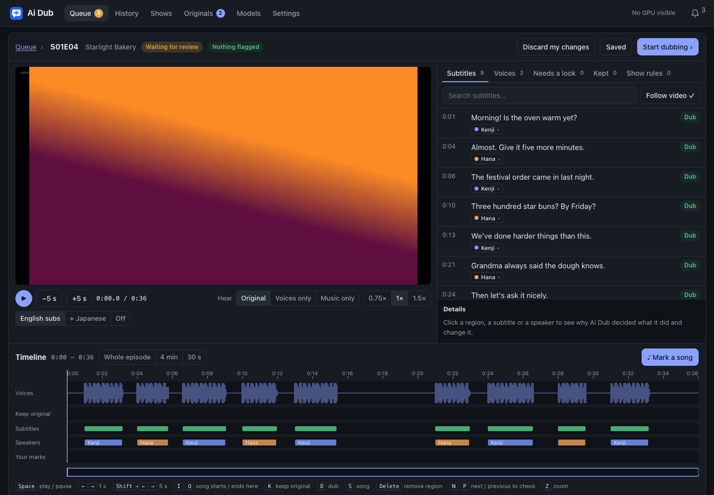
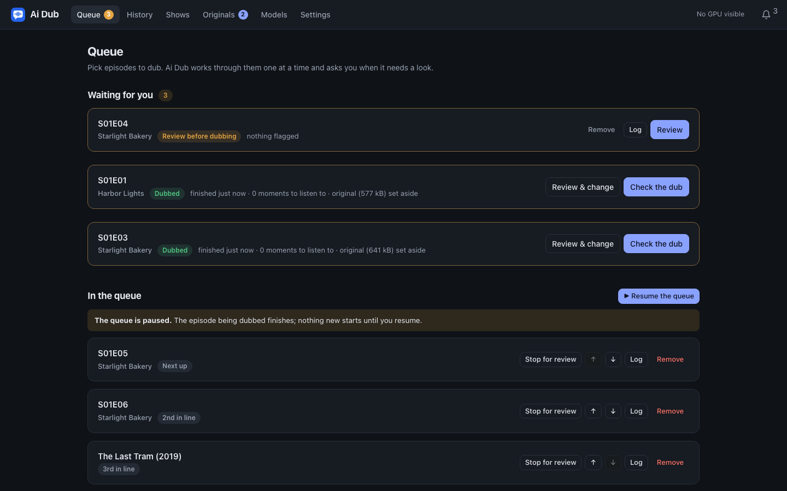
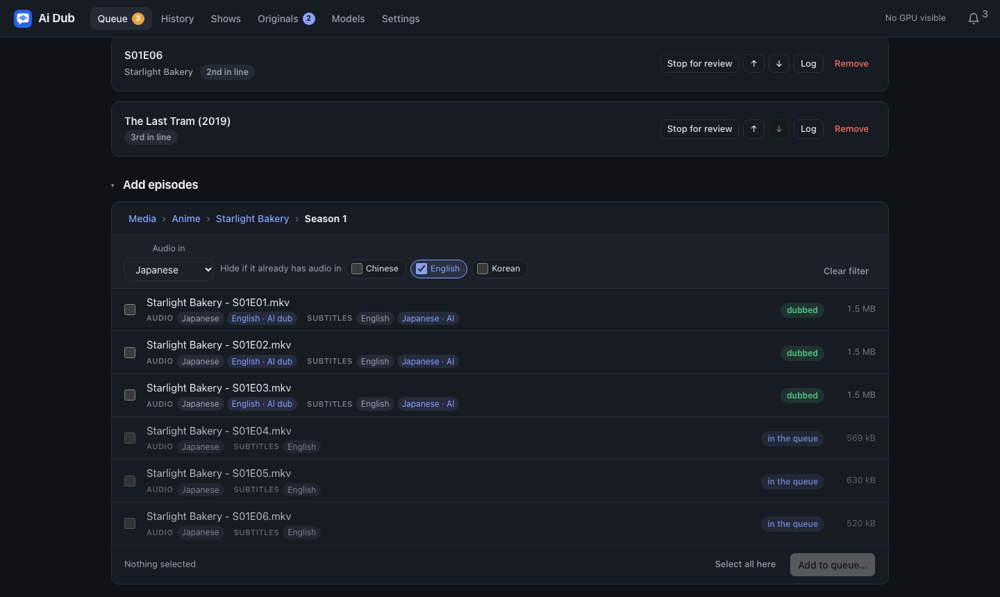
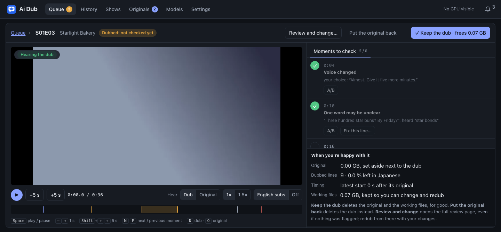
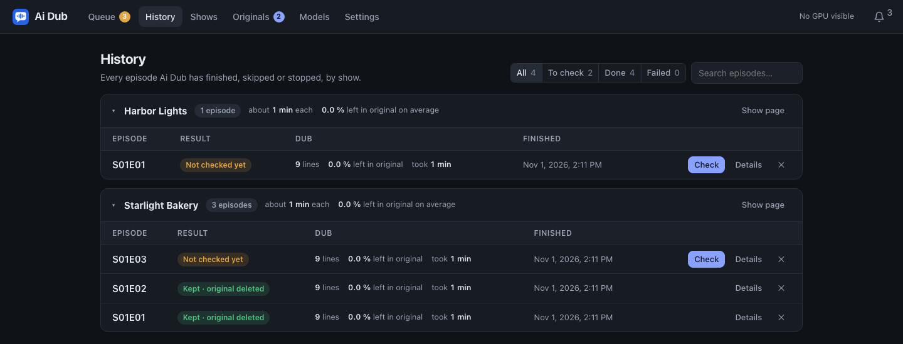
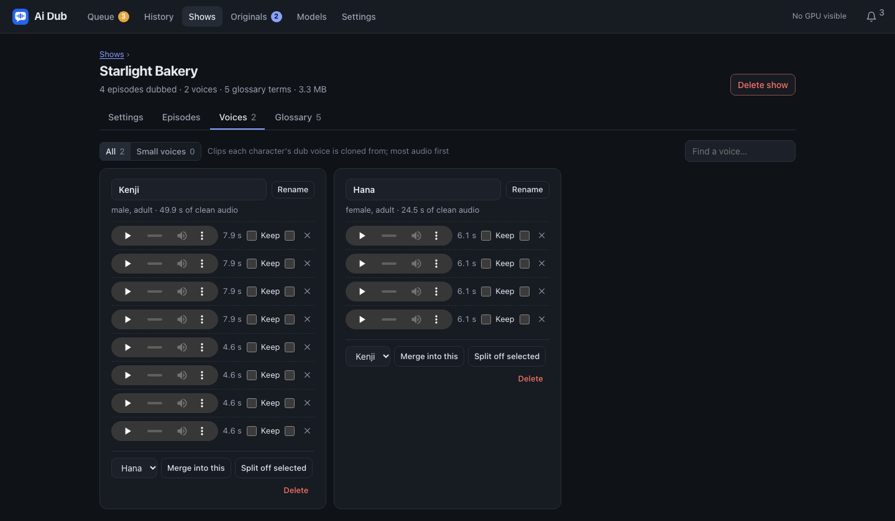

# Ai Dub

Local, voice-cloned dubbing of foreign-language video into English.

Ai Dub takes a film or episode (Japanese, Korean, Mandarin, Cantonese, …) and
adds an **"English (AI dub)"** audio track to the file:

- every speaker keeps their own voice, cloned from their own lines;
- each line is timed to the original performance;
- the original music, effects, laughs, gasps, songs and lines already in
  English are kept as they were;
- a good English subtitle is used as the source of the text when there is
  one, with speech recognition and translation filling the gaps;
- subtitle tracks are added for languages the file has none in.

Everything runs locally on your own GPU. No audio or text is sent to any
cloud service. The only outside contact is subtitle lookups through your own
Bazarr (optional) and the one-time model downloads.

> For personal use with media you own. The dub clones real actors' voices:
> don't distribute dubbed files. Added tracks are labelled "AI dub" and carry
> a version stamp.



**Documentation**

| | |
|---|---|
| [Setup](docs/setup.md) | Requirements, installing with Docker, Docker Compose or Unraid, first run, updating, backups |
| [Configuration](docs/configuration.md) | `config.yaml`, keys, environment variables, per-show settings, the settings worth knowing |
| [Troubleshooting](docs/troubleshooting.md) | Jobs that wait, skip or fail; model installs; Bazarr; disk space; dubs that sound wrong |

## Screenshots

All screenshots use a made-up demo library.

| | |
|---|---|
|  |  |
| **Queue**: what's waiting for you, what's next, pause | **Add episodes**: each file's audio and subtitle languages, and the language filter |
|  |  |
| **Check** a finished dub before its original is deleted | **History**, grouped by show |
|  | |
| **Shows**: each character's cloned voice references | |

## How it works

```
ingest → separate dialogue from music & effects → find scenes → who speaks when
→ speech recognition → sound events → subtitles (find, sync, score) → align lines
→ who is talking on screen (optional) → the show's voice bank → [review] → English
script (local LLM) → voice-cloned takes → back-check takes → choose takes → shorten
lines that don't fit → restore full bandwidth → mix → listen back → deliver (new
file) → [check]
```

Each step is checkpointed: a job that is stopped or interrupted (a container
restart, say) carries on from its first unfinished step.

| Step | Default model | Licence |
|---|---|---|
| Dialogue separation | MelBand-RoFormer via [audio-separator](https://github.com/nomadkaraoke/python-audio-separator) | MIT tool; weights per their authors |
| Diarization (who speaks when) | [Nemotron 3 Diarization](https://huggingface.co/nvidia/Nemotron-3-Diarization) | OpenMDW-1.1 |
| Voice matching | [SpeechBrain ECAPA](https://huggingface.co/speechbrain/spkrec-ecapa-voxceleb) | Apache-2.0 |
| Gender / age range | [audeering wav2vec2 age-gender](https://huggingface.co/audeering/wav2vec2-large-robust-24-ft-age-gender) | CC-BY-NC-SA-4.0 (non-commercial) |
| Text similarity (subtitle vs speech) | [LaBSE](https://huggingface.co/sentence-transformers/LaBSE) | Apache-2.0 |
| Speech recognition + word timing | [Qwen3-ASR 1.7B + ForcedAligner 0.6B](https://github.com/QwenLM/Qwen3-ASR) | Apache-2.0 |
| Sound events / emotion / sung pitch | [SenseVoice-Small](https://github.com/FunAudioLLM/SenseVoice), FCPE | FunASR model licence; FCPE MIT |
| Who is talking on screen (optional) | [Light-ASD](https://github.com/Junhua-Liao/Light-ASD), [YuNet and SFace](https://github.com/opencv/opencv_zoo) | MIT, MIT, Apache-2.0 |
| Picture subtitles (PGS OCR) | [PaddleOCR](https://github.com/PaddlePaddle/PaddleOCR) PP-OCRv6 (ONNX, CPU) | Apache-2.0 |
| Translation | [Qwen3.8-27B](https://huggingface.co/Qwen/Qwen3.8-27B), 4-bit, on [vLLM](https://github.com/vllm-project/vllm) | Apache-2.0 |
| Voice cloning | [IndexTTS-2.5](https://github.com/index-tts/index-tts) | bilibili Model Use License |
| Bandwidth extension | [FlashSR](https://github.com/jakeoneijk/FlashSR_Inference) | no licence declared by its authors |
| Generic voices (minor speakers) | [Qwen3-TTS VoiceDesign](https://github.com/QwenLM/Qwen3-TTS) | Apache-2.0 |

**No model is included in this repository or the Docker image.** Each model
is downloaded from its official source when you install it from the
**Models** page, and runs in its own Python environment inside the container.
Check each model's licence before you install it. Models can be swapped in
`config.yaml`; a model that is chosen but not installed stops the job with a
clear error rather than silently using another.

## Your files are safe

- A job never re-encodes, changes or deletes the original. The new file is
  written next to it under a temporary name and checked: every track, chapter
  and attachment is present, the durations are equal, and it decodes at the
  start and end. Only then does the new file take the original's name. The
  original is set aside as `<name>.<ext>.aidub-original`.
- A set-aside original is deleted only when you say so: **✓ Keep the dub** on
  the check screen, or **Delete** on the **Originals** page. Nothing deletes
  it on a timer.
- Files that already have English audio are skipped. So are files whose
  untagged audio turns out to be English, and files already dubbed by Ai Dub
  (unless you tick **Redo**).
- Existing subtitle tracks are never replaced.
- Ai Dub can only see the media folders you mount and list in its config.

## Quick start

You need an NVIDIA GPU (built on a 32 GB card), Docker with the NVIDIA
container runtime, and about 100 GB of disk for models. [Setup](docs/setup.md)
has the details, Docker Compose and Unraid.

```bash
docker run -d --name ai-dub --runtime=nvidia --restart unless-stopped \
  -e NVIDIA_VISIBLE_DEVICES=all -e PUID=99 -e PGID=100 -e TZ=America/Los_Angeles \
  -p 8790:8790 \
  -v /path/to/appdata:/config \
  -v /path/to/models:/models \
  -v /path/to/work:/work \
  -v /path/to/movies:/media/movies \
  -v /path/to/shows:/media/shows \
  -v /path/to/anime:/media/anime \
  ghcr.io/pingpongshow/ai-dub:latest
```

Then open `http://<server>:8790`:

1. **Models**: **Install all missing** (about 50 GB of downloads; one at a
   time, each with a log), then **Make generic voices** once.
2. **Settings**: optionally switch on Bazarr and give it its API key, then
   restart the container.
3. **Queue**: browse your media, tick files (or **Add all…** for a folder),
   and add them.

## Using it

### Queue

Browse the mounted media folders, tick episodes, and add them. Each file shows
its audio and subtitle languages, including subtitle files next to it. The
language filter above the list does two things:

- **Audio in**: shows only files with audio in that language.
- **Hide if it already has audio in**: hides files that already have, for
  example, English audio. A dub Ai Dub added counts, and so does a title that's
  in the queue or already dubbed.

**Select all here** and **Add all…** follow the filter. Options when adding:

- **Show**: guessed from the folder name. Episodes of the same show share
  voices, a glossary and rules.
- **Audio track** and **Language**: when the file has several tracks, or the
  track isn't tagged.
- **Review before dubbing**: the show's setting, Off, When unsure or Always.
  Tick the box to make the choice the show's setting.
- **Redo**: dub a file that Ai Dub has already dubbed.

One job runs at a time, in queue order; move jobs up or down to reorder. Each card shows its
step (for example 7/18), an estimated time left (once a few dubs have
finished), and **Log**, which opens a panel that stays until you close it.
**⏸ Pause the queue** lets the current job finish and starts nothing new
until you resume, even across restarts. **Waiting for you** at the top lists
episodes paused for review and dubs waiting to be checked.

### Review (before dubbing)

A job can stop once Ai Dub has worked out the songs and the speakers, before
it translates or voices anything. The review screen has:

- a small preview of the episode with its subtitles;
- a timeline of what keeps the original sound (songs, openings, credits),
  with Ai Dub's reasons;
- every subtitle with the voice it will be dubbed in;
- the speakers, with gender, age and voice;
- a **Needs a look** list of what Ai Dub was unsure of, red until decided;
- a **Kept** list of everything that stays in the original: songs, your marks,
  lines with no words, voices under music, crowds, English lines, and after a
  dub the lines left in Japanese;
- a **Songs** list of every section tagged as a song.

You can:

- drag or add regions;
- set a subtitle, line, region or flagged stretch to keep, dub or song;
- mark a song with **♪ Mark a song** (or the I and O keys);
- give a line to another speaker, and rename or merge speakers;
- write your own English for a line.

Then press **Start dubbing**. Openings and endings marked here can apply to
every episode of the show.

Keys: Space play/pause · ←/→ seek 1 s (Shift: 5 s) · K keep · D dub · S song
· N/P next/previous flag · I/O song start/end · Z zoom · Delete removes a
region.

The review is available after a dub too. Open it from the job, change
anything, and press **Redub with these changes**. The original goes back,
and the job restarts from its review step without redoing the analysis. To fix
a few lines only, voice them again from the check screen (below).

### Check (after dubbing)

When a dub finishes, Ai Dub deletes its working files but keeps a small
preview and the review data. Then it asks you to check the dub. The check
screen plays the preview with the original sound or the dub, and nothing is
left off its three lists:

- **To check**: lines left in the original language, subtitles nothing voiced,
  lines hard to hear in the mix, takes with an unclear word, doubtful voices,
  two people sharing a line, late lines.
- **Songs**: each kept song or title sequence, as one row.
- **Notes**: everything else worth knowing (lines sped up, subtitles that differ
  from the speech, lines voiced from their own clip).

Tick each one off as you go. For each, **A/B** plays the original and then the
dub. Keys: Space, ←/→, N/P (within the list), D (hear the dub), O (hear the
original).

Before any of this, the **Listen back** step has already heard the finished
track: a track silent while the original plays, or one where most lines can't be
made out, stops the job with the original untouched.

A line that came out wrong (a word missing or mangled) can be fixed right
there:

- **↻ Voice again** keeps the same words.
- **Change words…** lets you edit the English first.
- **Other speaker…** opens the line on the review page to give it another
  voice.

This works for any flagged moment, and for whatever line is playing (shown
under the player). Then press **Voice them again**. Only those lines are
redone, each with four fresh takes, and the dub comes back to be checked.

Then choose one:

- **✓ Keep the dub**: deletes the set-aside original and the check files,
  and shows how much space that frees.
- **Put the original back**: deletes the dub.
- **Review and change…**: opens the review page to change things and
  redub. On older dubs without review data, this button is **Redo with
  review**, which puts the original back and queues the episode again with a
  review stop.

To turn the check off, see [`verify.enabled`](docs/configuration.md#settings-worth-knowing).

### Other pages

- **History**: finished jobs grouped by show, with average time and how much
  was left in the original language. Earlier attempts at an episode are
  folded under the latest.
- **Shows**: one page per show, with four tabs:
  - **Settings**: honorifics, style and the show's rules.
  - **Episodes**: every file in the show's folders and its state; queue the
    rest from here.
  - **Voices**: rename and merge characters, hear their references, and see
    "sound like the same person?" suggestions.
  - **Glossary**: names and terms, edited in place.
- **Originals**: set-aside files with their sizes and the free disk space;
  restore or delete them. An original whose dub you haven't checked yet says
  so.
- **Models**: install, reinstall and view logs per model.
- **Settings**: review mode, Bazarr, keys, and the effective configuration.
- **🔔**: what finished, failed or is waiting for you.

## Development

```bash
python3.12 -m venv .venv && .venv/bin/pip install -e ".[dev]" pillow
.venv/bin/pytest -q            # needs ffmpeg; mkvmerge and rubberband optional
```

The tests run the whole pipeline on generated media with stand-in workers
(`tests/fakes`), so they need no GPU or models. CI runs the same tests on
every push and builds the image from `main`.

Command line (inside the container: `docker exec -it ai-dub aidub …`):

| Command | What it does |
|---|---|
| `aidub serve` | The web UI and queue (what the container runs) |
| `aidub doctor [worker…]` | Checks each model is installed, starts, and sees the GPU |
| `aidub setup [worker…] [--download] [--force]` | Builds model environments (and downloads weights) |
| `aidub voices [--force]` | Designs the generic minor-speaker voices |
| `aidub originals list\|scan\|restore\|delete ID… [--yes]` | Set-aside files |
| `aidub run FILE --preview 5m --output out.mkv` | Dubs the first minutes into a separate file; the source is untouched |

Layout:

- `aidub/`: pipeline steps, queue, API.
- `aidub/default_config.yaml`: every setting with its default.
- `workers/`: one folder per model, each with its own requirements and
  `worker.json`.
- `web/`: the UI, plain JS with no build step.
- `tests/` and `docker/`.
- `dev/`: model comparison tools, not shipped.

## Credits

Ideas borrowed from [OpenDub](https://github.com/estebanstifli/OpenDub)
(per-line audio, resumable steps, no silent fallbacks) and
[VideoLingo](https://github.com/Huanshere/VideoLingo) (translate → reflect →
rewrite, glossary extraction). Neither is included or run.

## Licence

MIT for this code ([LICENSE](LICENSE)). Each model has its own licence (see
the table above).
